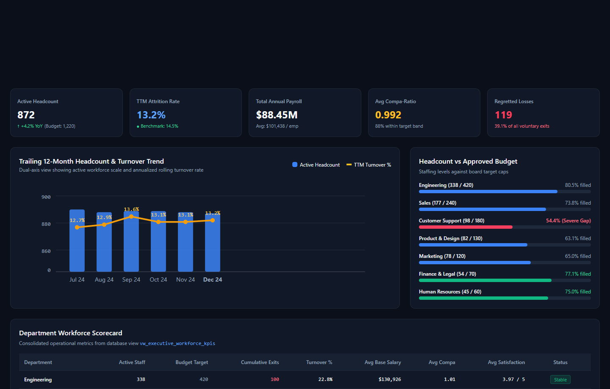
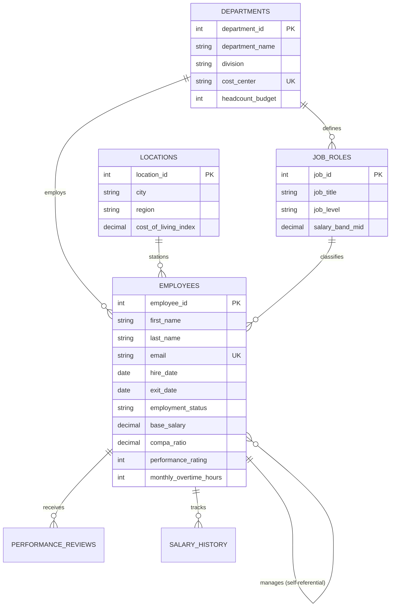
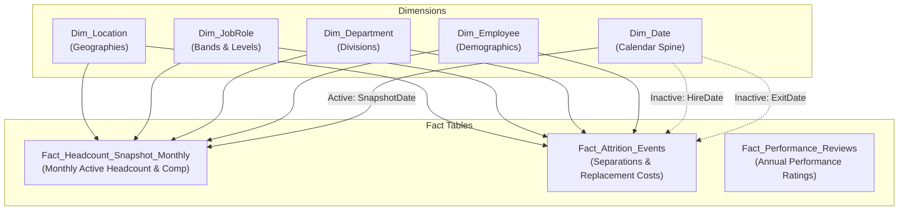
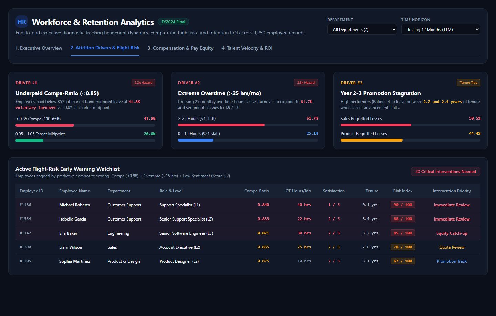
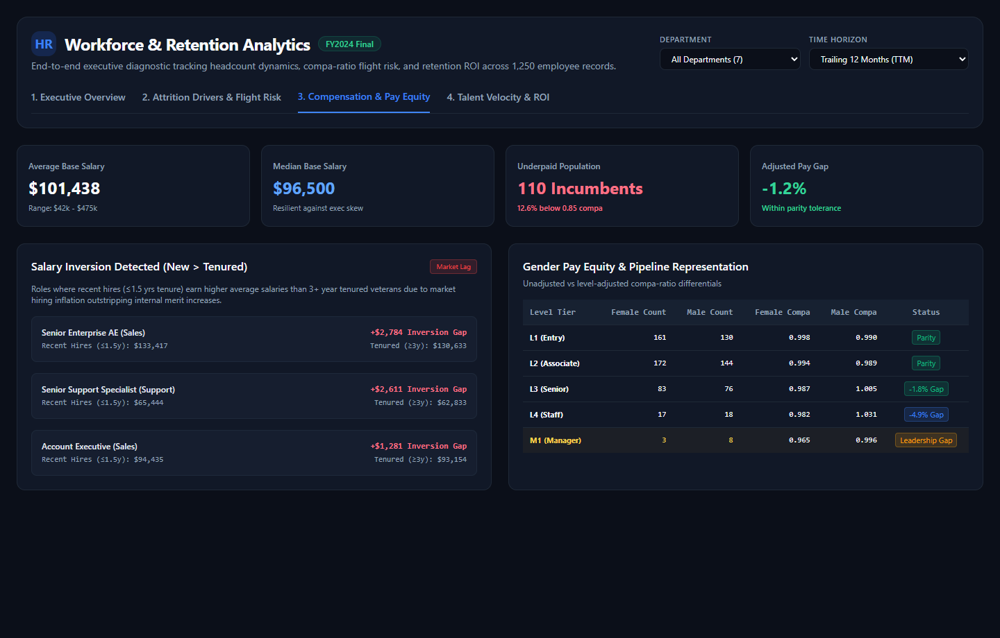
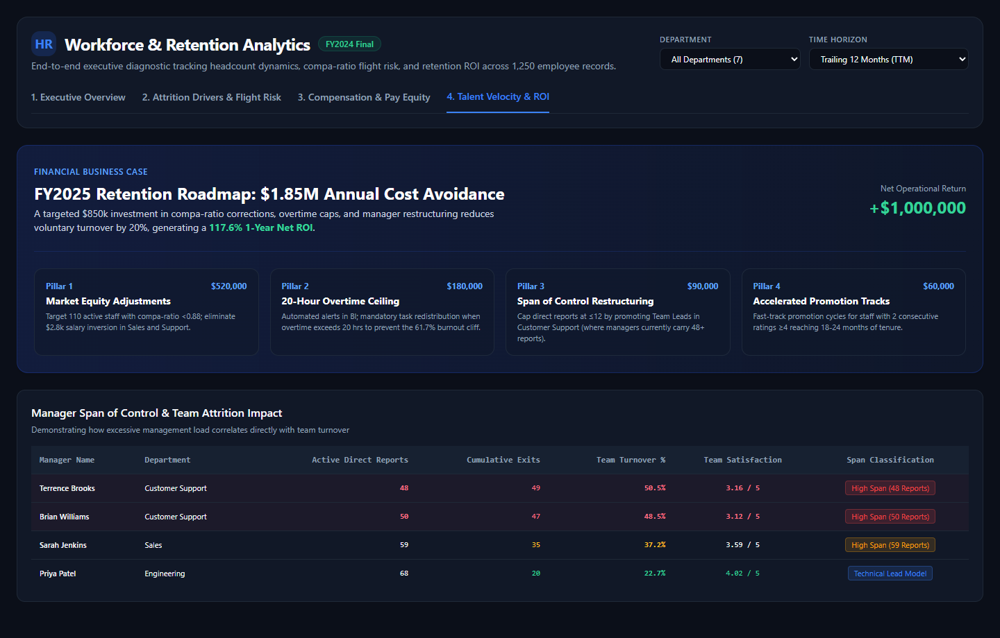

# HR Analytics: End-to-End SQL & Power BI Intelligence Suite


An enterprise-grade People Analytics portfolio project analyzing workforce headcount trends, salary band penetration, hiring velocity, and employee attrition drivers across a structured relational database of **1,250 employees** spanning 2018 to 2024.

This repository serves as a reference implementation for **relational database modeling**, **advanced SQL analysis** (multi-stage CTEs, window functions, self-joins), **Kimball dimensional modeling** in Power BI (resolving role-playing dates via `USERELATIONSHIP`), and **evidence-based C-suite retention strategy**.

---

## Executive Summary & Core KPIs



```
========================================================================================
                                HR ANALYTICS EXECUTIVE PULSE
========================================================================================
  [ Active Headcount ]    [ TTM Attrition Rate ]    [ Total Payroll ]    [ Avg Compa-Ratio ]
         872                    13.22%                   $88.45M                0.992
   (Budget: 1,220)       (Tech Avg: 14%-16%)       ($101.4k Avg)        (88% in Target Band)
----------------------------------------------------------------------------------------
  [ Total Separations ]   [ Regretted Losses ]     [ Cumulative Cost ]  [ Projected ROI ]
         378                     119                     $25.56M               117.6%
    (304 Voluntary)       (Rating 4-5 Stars)       ($67.6k / Exit)      ($1.85M Savings)
========================================================================================
```

### Key Business Takeaways:
1. **Turnover Velocity**: The enterprise Trailing 12-Month (TTM) turnover rate sits at **13.22%**, within healthy macro bounds, but masking severe departmental and role-level attrition.
2. **The 3 Primary Attrition Drivers**:
   - **Compa-Ratio $< 0.85$**: Doubles voluntary turnover to **41.8%** (vs. 20.0% at market midpoint).
   - **Monthly Overtime $> 25$ Hours**: Triples turnover to **61.7%**, crashing employee satisfaction from 4.2 to 1.9.
   - **Tenure Stagnation (2.0–2.5 Years)**: 50.5% of high performers in Sales and 44.4% in Product voluntarily depart around year two due to promotion bottlenecks.
3. **Salary Compression Detected**: Aggressive external hiring produced pay inversion in Sales and Support, where recent hires earn up to **$2,800 more** than 3+ year tenured peers.
4. **Actionable Financial ROI**: An **$850,000 targeted retention fund** (equity corrections, overtime caps, span restructuring) yields **$1.85M in gross annual replacement savings** (**117% 1-Year Net ROI**).

---

## Repository Structure

```
resilient-turing/
├── README.md                                <- Central project portfolio documentation
├── RESUME_BULLETS_AND_TALKING_POINTS.md     <- Resume bullets (XYZ format), technical interview Q&A
├── schema/
│   ├── 01_schema_definition.sql             <- Production DDL with constraints, PKs, FKs, and indexes
│   ├── schema_documentation.md              <- Full data dictionary, business rules & metrics
│   └── er_diagram.mermaid                   <- Relational entity-relationship diagram
├── sql/
│   ├── 01_data_profiling_and_qc.sql         <- Data quality checks, anomaly audits, integrity tests
│   ├── 02_workforce_mix_and_headcount.sql   <- Headcount vs budget, span of control, remote ratios
│   ├── 03_hiring_patterns_and_velocity.sql  <- Quarterly hiring velocity, cumulative totals, cohorts
│   ├── 04_compensation_and_equity.sql       <- Compa-ratios, NTILE quartiles, salary compression
│   ├── 05_attrition_and_retention.sql       <- Tenure hazards, overtime burnout, regretted losses
│   ├── 06_advanced_window_functions_and_ctes.sql <- Trailing 12M moving turnover, LAG salary jumps
│   └── 07_executive_reporting_views.sql     <- Production views for BI tools (early-warning risk)
├── power_bi/
│   ├── power_bi_data_model.md               <- Star schema architecture & USERELATIONSHIP design
│   ├── dax_measures_library.md              <- 25+ production DAX measures with full code & comments
│   └── dashboard_wireframes_and_specs.md    <- 4-page executive dashboard visual specifications
├── analysis/
│   ├── business_questions_and_findings.md   <- 10 strategic questions with SQL, results & insights
│   └── executive_retention_strategy_brief.md <- C-suite retention memo with cost-of-turnover model
├── scripts/
│   ├── generate_dataset.py                  <- Python synthetic data engine with reproducible seed
│   └── run_sql_analysis.py                  <- Automated test runner executing all SQL modules
└── data/
    ├── hr_analytics.db                      <- Populated SQLite relational database
    ├── HR_Analytics_Executive_Model.xlsx    <- Multi-sheet Excel workbook with pivot models
    ├── raw_csv/                             <- Relational CSV files (6 core entities)
    └── powerbi_star_schema/                 <- Power BI ready Star Schema extracts (8 tables)
```

---

## Relational Architecture & Entity-Relationship Diagram



Full field definitions and constraint documentation are available in [schema_documentation.md](file:///c:/Users/Asus/Documents/antigravity/resilient-turing/schema/schema_documentation.md).

---

## Power BI Star Schema Architecture

To deliver sub-second report interactivity across 44,000+ monthly snapshot records, data is structured into a pure Kimball Star Schema:



### Role-Playing Dates with `USERELATIONSHIP`:
To prevent cyclic relationships and ambiguity, `Dim_Date` links actively to monthly headcount snapshots, while exit events are dynamically evaluated using inactive relationships activated inside DAX:
```dax
Total Exits = 
CALCULATE(
    COUNTROWS(Fact_Attrition_Events),
    USERELATIONSHIP(Dim_Date[Date], Fact_Attrition_Events[ExitDate])
)
```

See [power_bi_data_model.md](file:///c:/Users/Asus/Documents/antigravity/resilient-turing/power_bi/power_bi_data_model.md) and [dax_measures_library.md](file:///c:/Users/Asus/Documents/antigravity/resilient-turing/power_bi/dax_measures_library.md) for the complete 25+ DAX measure library.

---

## Advanced SQL Highlights

### 1. Trailing 12-Month (TTM) Moving Turnover via Multi-Stage CTE
```sql
WITH monthly_spine AS (
    SELECT DISTINCT strftime('%Y-%m', hire_date) AS month_key,
           date(hire_date, 'start of month', '+1 month', '-1 day') AS month_end_date
    FROM employees WHERE hire_date >= '2023-01-01'
),
monthly_metrics AS (
    SELECT s.month_key, s.month_end_date,
           COUNT(CASE WHEN e.hire_date <= s.month_end_date AND (e.exit_date IS NULL OR e.exit_date > s.month_end_date) THEN 1 END) AS active_headcount,
           COUNT(CASE WHEN e.exit_date BETWEEN date(s.month_end_date, 'start of month') AND s.month_end_date THEN 1 END) AS monthly_exits
    FROM monthly_spine s CROSS JOIN employees e GROUP BY s.month_key, s.month_end_date
),
rolling AS (
    SELECT month_key, active_headcount, monthly_exits,
           SUM(monthly_exits) OVER (ORDER BY month_key ROWS BETWEEN 11 PRECEDING AND CURRENT ROW) AS exits_trailing_12m,
           AVG(active_headcount) OVER (ORDER BY month_key ROWS BETWEEN 11 PRECEDING AND CURRENT ROW) AS avg_headcount_trailing_12m
    FROM monthly_metrics
)
SELECT month_key, active_headcount, exits_trailing_12m,
       ROUND((exits_trailing_12m * 100.0) / NULLIF(avg_headcount_trailing_12m, 0), 2) AS ttm_turnover_rate_pct
FROM rolling ORDER BY month_key DESC LIMIT 6;
```

### 2. Salary Inversion & Compression Audit
Detects inverted roles where recent hires earn more than veteran employees:
```sql
WITH role_tenure AS (
    SELECT j.job_title, d.department_name,
           AVG(CASE WHEN e.tenure_years <= 1.5 THEN e.base_salary END) AS recent_hire_avg,
           AVG(CASE WHEN e.tenure_years >= 3.0 THEN e.base_salary END) AS tenured_avg
    FROM employees e 
    JOIN job_roles j ON e.job_id = j.job_id 
    JOIN departments d ON e.department_id = d.department_id
    WHERE e.employment_status = 'Active'
    GROUP BY j.job_id, j.job_title, d.department_name
)
SELECT job_title, department_name, 
       ROUND(recent_hire_avg, 0) AS recent_hire_avg,
       ROUND(tenured_avg, 0) AS tenured_avg,
       ROUND(recent_hire_avg - tenured_avg, 0) AS compression_gap
FROM role_tenure WHERE recent_hire_avg > tenured_avg;
```

### 3. Career Advancement Velocity using `LAG()`
Tracks nominal dollar and percentage salary jumps across career milestones:
```sql
SELECT employee_id, effective_date, change_reason, new_salary,
       LAG(new_salary, 1) OVER (PARTITION BY employee_id ORDER BY effective_date) AS prev_salary,
       new_salary - LAG(new_salary, 1) OVER (PARTITION BY employee_id ORDER BY effective_date) AS dollar_gain,
       salary_change_pct
FROM salary_history
WHERE change_reason IN ('Annual Merit', 'Promotion', 'Market Adjustment');
```

---

## Dashboard Visual Layout & Gallery

The reporting suite features a 4-page interactive reporting layout configured in [dashboard_wireframes_and_specs.md](file:///c:/Users/Asus/Documents/antigravity/resilient-turing/power_bi/dashboard_wireframes_and_specs.md) and available standalone in [`dashboard.html`](file:///c:/Users/Asus/Documents/antigravity/resilient-turing/dashboard.html):

### 1. Executive Workforce & Headcount Dynamics
*High-level strategic pulse tracking active headcount (872), trailing 12-month turnover rate (13.2%), total payroll ($88.4M), and departmental budget variances.*


### 2. Attrition Drivers & Flight Risk Intelligence
*Diagnostic view isolating the 3 primary turnover hazards (compa-ratio <0.85, chronic overtime >25 hrs/mo, year 2-3 stagnation) alongside the active flight-risk watchlist.*


### 3. Compensation Architecture & Pay Equity
*Salary band penetration, median benchmarks, gender pay equity by career tier, and the $2,784 salary inversion audit.*


### 4. Talent Velocity & Retention ROI Roadmap
*The evidence-based 4-pillar retention roadmap modeling an $850k investment yielding $1.85M in gross replacement savings (117.6% 1-year net ROI).*


---

## Quick Start & Verification

### Prerequisites
- Python 3.9+ with `pandas`, `numpy`, `openpyxl`, and `sqlite3`
- Power BI Desktop (optional, for opening star-schema CSVs)
- Excel 2016+ (for viewing `HR_Analytics_Executive_Model.xlsx`)

### 1. Regenerate Dataset & Database
```bash
python scripts/generate_dataset.py
```
*Outputs: `data/hr_analytics.db`, `data/HR_Analytics_Executive_Model.xlsx`, and all raw/star schema CSV files.*

### 2. Validate All SQL Queries & Views
```bash
python scripts/run_sql_analysis.py
```
*Executes all 7 SQL modules against SQLite, asserting zero errors and printing sample outputs.*

### 3. Open in Power BI
1. Launch Power BI Desktop.
2. Select **Get Data** $\rightarrow$ **Folder** or **Text/CSV**.
3. Select the files in [`data/powerbi_star_schema/`](file:///c:/Users/Asus/Documents/antigravity/resilient-turing/data/powerbi_star_schema/).
4. Apply the relationships outlined in [power_bi_data_model.md](file:///c:/Users/Asus/Documents/antigravity/resilient-turing/power_bi/power_bi_data_model.md).
5. Copy the measures from [dax_measures_library.md](file:///c:/Users/Asus/Documents/antigravity/resilient-turing/power_bi/dax_measures_library.md).

---

## Strategic Retention Roadmap & Financial ROI

```
+----------------------------------------------------+--------------------------+
| Budgeted Intervention Costs (FY2025)               | Amount ($ USD)           |
+----------------------------------------------------+--------------------------+
| 1. Compa-Ratio Market Corrections (110 Incumbents) | $520,000                 |
| 2. Overtime Mitigation & Contractor Load Balancing | $180,000                 |
| 3. Management Span Restructuring & Training        | $90,000                  |
| 4. BI Early-Warning Tooling & Retention Programs   | $60,000                  |
| TOTAL INVESTMENT                                   | $850,000                 |
+----------------------------------------------------+--------------------------+
| Projected Financial Returns (FY2025)               | Financial Impact         |
+----------------------------------------------------+--------------------------+
| Current Annual Departures                          | 116 Departures / Year    |
| Targeted Reduction (20% Reduction)                 | 23 Avoided Departures    |
| Average Avoided Replacement Cost                   | $80,430 / Departure      |
| GROSS REPLACEMENT SAVINGS                          | $1,850,000               |
| NET OPERATIONAL SAVINGS (Savings - Investment)     | +$1,000,000              |
| 1-YEAR PROJECTED RETURN ON INVESTMENT (ROI)        | 117.6%                   |
+----------------------------------------------------+--------------------------+
```

Read the full executive memorandum in [executive_retention_strategy_brief.md](file:///c:/Users/Asus/Documents/antigravity/resilient-turing/analysis/executive_retention_strategy_brief.md).

---

## Resume Bullets & Interview Guide
For STAR / XYZ format resume bullet points, interview answers regarding `USERELATIONSHIP`, CTEs, window functions, and flight risk index formulation, refer to [RESUME_BULLETS_AND_TALKING_POINTS.md](file:///c:/Users/Asus/Documents/antigravity/resilient-turing/RESUME_BULLETS_AND_TALKING_POINTS.md).

---

