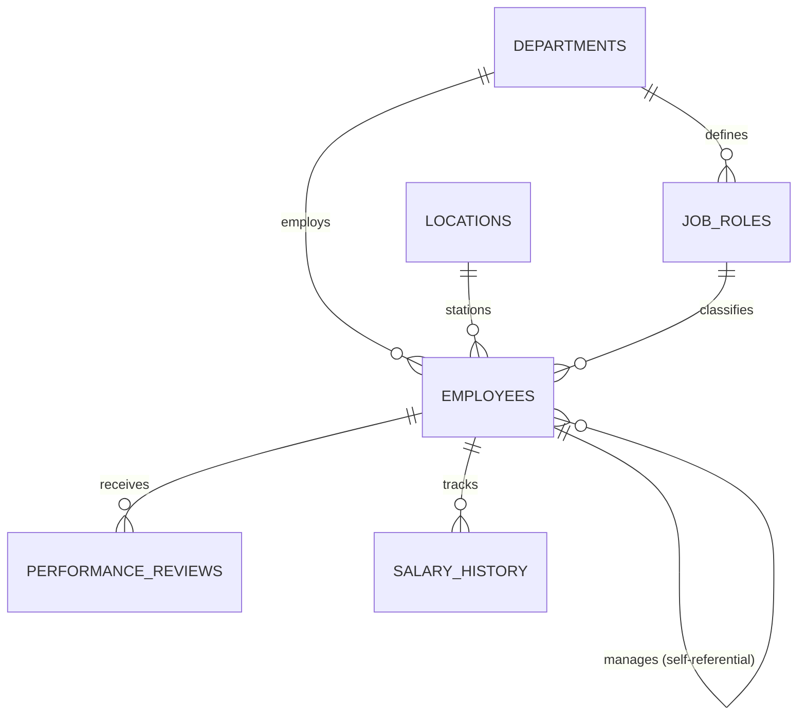

# Schema Documentation & Data Dictionary

This document details the relational data architecture of the HR Analytics platform, encompassing 6 normalized core tables, entity relationships, business rules, field-level constraints, and data definitions.

---

## 1. Relational Architecture Overview

The database is designed with high relational integrity, supporting full normalization (3NF) for transactional record-keeping and rapid aggregation for people analytics and executive reporting.

---

## 2. Table-by-Table Data Dictionary

### Table: `departments`
Stores organizational business units, divisions, cost centers, and approved headcount allocations.

| Column | Type | Nullable | Key | Description / Validation Rules |
| :--- | :--- | :---: | :---: | :--- |
| `department_id` | `INTEGER` | NO | PK | Unique identifier for each operational department (1 to 7). |
| `department_name` | `VARCHAR(100)` | NO | | Functional name (e.g., Engineering, Sales, Customer Support). |
| `division` | `VARCHAR(100)` | NO | | Higher-level organizational division (`Technology`, `Commercial`, `Operations`, `Corporate`). |
| `cost_center` | `VARCHAR(20)` | NO | UK | Accounting GL code (e.g., `CC-101`, `CC-102`). Unique across the enterprise. |
| `headcount_budget` | `INTEGER` | NO | | Board-approved target headcount for workforce planning variance audits. Must be > 0. |

---

### Table: `locations`
Represents physical offices and remote regional talent hubs.

| Column | Type | Nullable | Key | Description / Validation Rules |
| :--- | :--- | :---: | :---: | :--- |
| `location_id` | `INTEGER` | NO | PK | Unique location identifier (1 to 6). |
| `city` | `VARCHAR(100)` | NO | | Metro location (e.g., New York, San Francisco, London, Austin, Remote Hub). |
| `state_province` | `VARCHAR(100)` | NO | | State or province abbreviation / territory. |
| `country` | `VARCHAR(50)` | NO | | Country name (e.g., USA, UK). |
| `region` | `VARCHAR(50)` | NO | | Geographic reporting region (`North America`, `EMEA`, `Distributed`). |
| `cost_of_living_index` | `DECIMAL(4,2)` | NO | | Relative Cost of Living (COLI) benchmark where 1.00 = national baseline. |
| `office_type` | `VARCHAR(50)` | NO | | Classification: `Corporate HQ`, `Regional HQ`, `Tech Hub`, `Branch Office`, `Virtual`. |

---

### Table: `job_roles`
Defines job titles, career hierarchy levels, and official salary compensation bands.

| Column | Type | Nullable | Key | Description / Validation Rules |
| :--- | :--- | :---: | :---: | :--- |
| `job_id` | `INTEGER` | NO | PK | Unique job role identifier (1 to 26). |
| `job_title` | `VARCHAR(100)` | NO | | Standardized title (e.g., `Senior Software Engineer`, `Account Executive`). |
| `department_id` | `INTEGER` | NO | FK | Foreign key referencing `departments(department_id)`. |
| `job_level` | `VARCHAR(20)` | NO | | Career tier: `L1` (Entry), `L2` (Associate), `L3` (Mid), `L4` (Senior), `L5` (Staff), `M1` (Mgr), `M2` (Dir), `E1` (Exec). |
| `salary_band_min` | `DECIMAL(12,2)`| NO | | Minimum compensation baseline for the grade. Must be > 0. |
| `salary_band_mid` | `DECIMAL(12,2)`| NO | | Market midpoint of the grade band (used to compute Compa-Ratio). |
| `salary_band_max` | `DECIMAL(12,2)`| NO | | Maximum compensation cap for the grade. Must be >= `salary_band_mid`. |

---

### Table: `employees`
The central employee master record, containing demographic, employment lifecycle, compensation, workload, and sentiment metrics.

| Column | Type | Nullable | Key | Description / Business Rules |
| :--- | :--- | :---: | :---: | :--- |
| `employee_id` | `INTEGER` | NO | PK | Unique employee ID (1001 to 2250). |
| `first_name` | `VARCHAR(50)` | NO | | Employee legal first name. |
| `last_name` | `VARCHAR(50)` | NO | | Employee legal surname. |
| `email` | `VARCHAR(100)` | NO | UK | Corporate email address. Must be unique. |
| `gender` | `VARCHAR(20)` | NO | | Self-reported gender (`Female`, `Male`, `Non-Binary`). |
| `birth_date` | `DATE` | NO | | Date of birth. |
| `education_level` | `VARCHAR(50)` | NO | | Highest degree (`Associate / High School`, `Bachelor's`, `Master's`, `Doctorate`). |
| `hire_date` | `DATE` | NO | | Date employee joined the company. |
| `exit_date` | `DATE` | YES | | Separation date (NULL for currently active staff). Must be >= `hire_date`. |
| `employment_status` | `VARCHAR(20)` | NO | | Status indicator: `'Active'` or `'Terminated'`. |
| `termination_type` | `VARCHAR(30)` | YES | | Reason category: `'Voluntary'`, `'Involuntary'`, `'Retirement'`, or NULL if active. |
| `termination_reason`| `VARCHAR(100)`| YES | | Specific departure driver (e.g., `'Better Compensation'`, `'Workplace Burnout'`). |
| `department_id` | `INTEGER` | NO | FK | Foreign key referencing `departments(department_id)`. |
| `job_id` | `INTEGER` | NO | FK | Foreign key referencing `job_roles(job_id)`. |
| `manager_id` | `INTEGER` | YES | FK | Self-referencing FK to `employees(employee_id)`. NULL for CEO. |
| `location_id` | `INTEGER` | NO | FK | Foreign key referencing `locations(location_id)`. |
| `base_salary` | `DECIMAL(12,2)`| NO | | Current annualized base salary in USD. |
| `compa_ratio` | `DECIMAL(5,3)` | NO | | Ratio of `base_salary` to `job_roles.salary_band_mid`. Formula: $\text{Base Salary} / \text{Band Midpoint}$. |
| `performance_rating`| `INTEGER` | NO | | Most recent annual appraisal rating on a 1 (Unsatisfactory) to 5 (Exemplary) scale. |
| `satisfaction_score`| `INTEGER` | NO | | Internal employee engagement survey pulse (1 = Very Dissatisfied to 5 = Very Satisfied). |
| `work_life_balance_score`| `INTEGER`| NO | | Self-reported work-life balance score (1 to 5). |
| `monthly_overtime_hours`| `INTEGER` | NO | | Average monthly hours logged beyond 40-hr standard workweek. |
| `remote_ratio_pct`| `INTEGER` | NO | | Remote work percentage: `0` (On-site), `50` (Hybrid), `100` (Fully Remote). |
| `promotions_count`| `INTEGER` | NO | | Cumulative internal career promotions achieved during tenure. |
| `last_promotion_date`| `DATE` | YES | | Date of most recent career level change (NULL if never promoted). |
| `tenure_years` | `DECIMAL(5,2)`| NO | | Total service duration in years (computed from `hire_date` to `exit_date` or snapshot date). |

---

### Table: `performance_reviews`
Historical performance appraisals for multi-year cohort velocity, rating distributions, and potential matrix analysis.

| Column | Type | Nullable | Key | Description / Business Rules |
| :--- | :--- | :---: | :---: | :--- |
| `review_id` | `INTEGER` | NO | PK | Unique appraisal record ID. |
| `employee_id` | `INTEGER` | NO | FK | Foreign key referencing `employees(employee_id)`. |
| `review_year` | `INTEGER` | NO | | Performance appraisal calendar year (2020 through 2024). |
| `review_date` | `DATE` | NO | | Exact date appraisal was finalized (annual cycle: December 15). |
| `rating` | `INTEGER` | NO | | Year-end performance score (1 to 5 scale). |
| `goals_met_pct` | `INTEGER` | NO | | Percentage of annual OKRs/KPIs attained (50% to 130%). |
| `potential_rating` | `VARCHAR(20)` | NO | | 9-Box talent grid assessment (`'Low'`, `'Medium'`, `'High'`). |

---

### Table: `salary_history`
Granular historical record of all compensation modifications, tracking merit increases, career advancements, and market adjustments.

| Column | Type | Nullable | Key | Description / Business Rules |
| :--- | :--- | :---: | :---: | :--- |
| `history_id` | `INTEGER` | NO | PK | Unique compensation change event ID. |
| `employee_id` | `INTEGER` | NO | FK | Foreign key referencing `employees(employee_id)`. |
| `effective_date` | `DATE` | NO | | Date salary adjustment took effect. |
| `previous_salary` | `DECIMAL(12,2)`| NO | | Annualized base salary immediately prior to change (0 for initial hire). |
| `new_salary` | `DECIMAL(12,2)`| NO | | Updated annualized base salary. Must be > 0. |
| `salary_change_pct`| `DECIMAL(6,2)` | NO | | Percentage increase/decrease: $((\text{New} - \text{Prev}) / \text{Prev}) \times 100$. |
| `change_reason` | `VARCHAR(50)` | NO | | Reason: `'New Hire'`, `'Annual Merit'`, `'Promotion'`, `'Market Adjustment'`. |

---

## 3. Key Business Rules & Formulas

1. **Compa-Ratio (Comparative Ratio)**:
   $$\text{Compa-Ratio} = \frac{\text{Base Salary}}{\text{Job Level Salary Band Midpoint}}$$
   - $\text{Compa-Ratio} < 0.85$: Underpaid / Market Disadvantage (High Flight Risk).
   - $0.85 \le \text{Compa-Ratio} \le 1.15$: Market Target Competitive Band.
   - $\text{Compa-Ratio} > 1.15$: Above-Market Compensation / Retention Anchor.

2. **Annualized Turnover Rate (%)**:
   $$\text{Turnover Rate} = \frac{\text{Total Separations}}{\text{Average Active Headcount}} \times 100$$

3. **Regretted Loss / Attrition**:
   - Any departure classified as `termination_type = 'Voluntary'` where the employee's `performance_rating >= 4`.

4. **Estimated Replacement Cost of Turnover**:
   - Non-technical / Operational roles: $0.50 \times \text{Base Salary}$
   - Engineering & Specialized roles: $0.75 \times \text{Base Salary}$
   - Senior Leadership / Executive roles ($L4+, M1+, E1$): $1.25 \times \text{Base Salary}$
